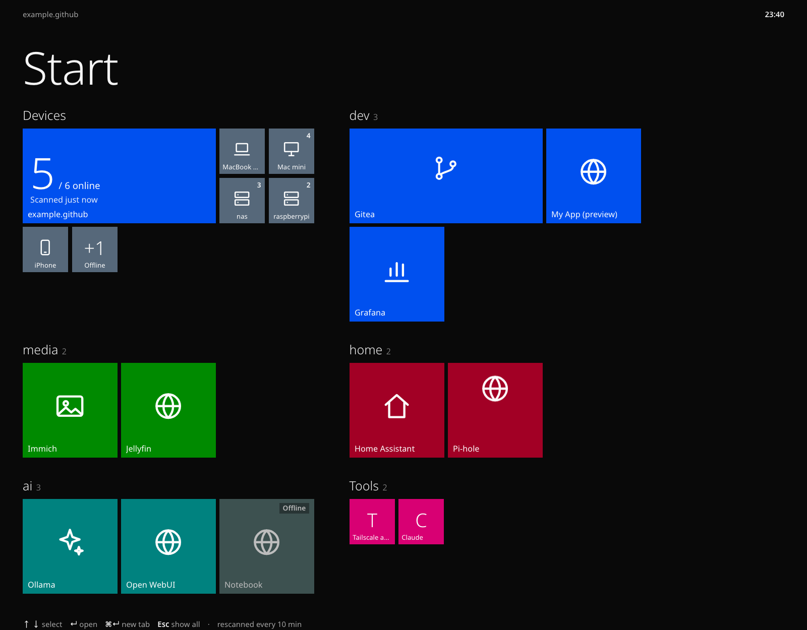
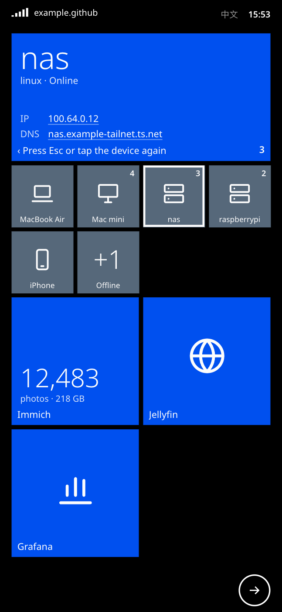
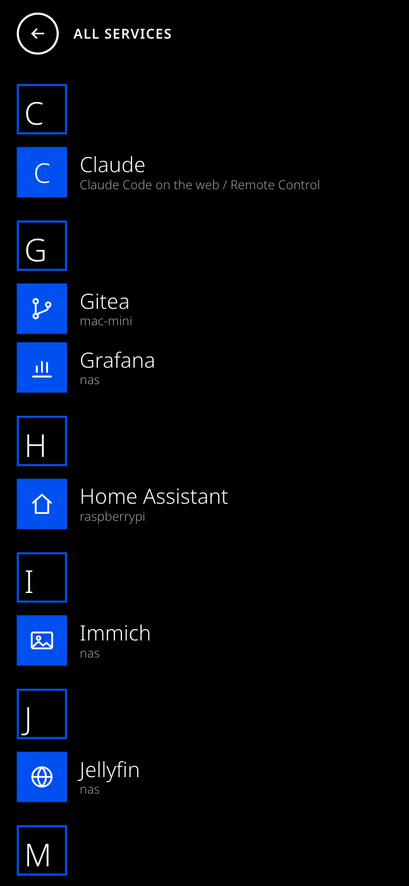
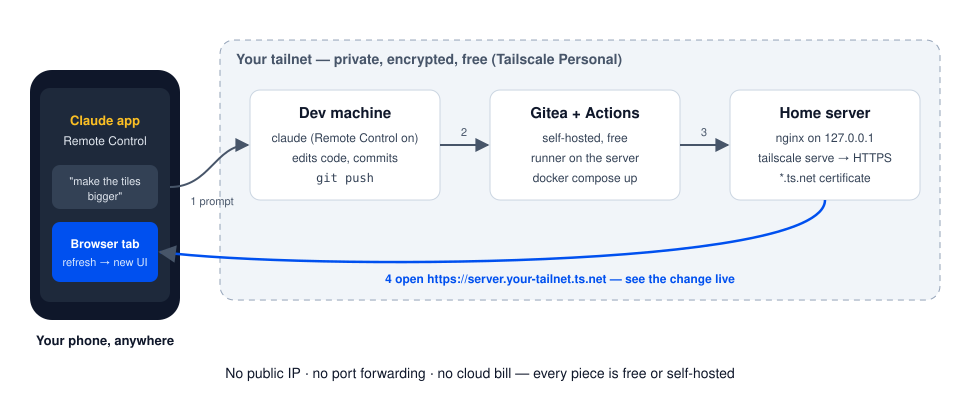

# Tailnet Home

[](https://github.com/muzig/tailscale-home/actions/workflows/ci.yml) [](https://github.com/muzig/tailscale-home/releases) [](LICENSE)

[English](README.md) · [简体中文](README.zh-CN.md) · **[Live demo](https://muzig.github.io/tailscale-home/)** — best on a phone

A start page for your [Tailscale](https://tailscale.com) network — every device and every self-hosted service on one Metro-style screen — **plus a free, private dev loop**: ask Claude to change the code from your phone, and refresh the browser on the same phone to see it live.

<p align="center">
  
</p>
<p align="center">
  
  &nbsp;
  
  &nbsp;
  
</p>
<p align="center"><sub>Desktop · on a phone: the Start screen in motion, device details, A–Z list</sub></p>

<sub>Screenshots use the fake tailnet in <code>demo/data.json</code>.</sub>

## Why

- **Develop from anywhere with Claude Code Remote Control.** Leave `claude` running on your dev machine with Remote Control on, then drive it from the Claude app on your phone.
- **See every change in a real browser, right away.** `git push` → self-hosted Gitea Actions builds and redeploys → open `https://<server>.<tailnet>.ts.net` on your phone. No screenshots pasted back and forth — you look at the actual page.
- **Free.** Tailscale's Personal plan, Gitea, Docker and nginx cost nothing. No VPS, no public IP, no port forwarding, no domain, no certificate to buy — `tailscale serve` gives you HTTPS on `*.ts.net`. The only thing you need is the Claude plan you already use for Claude Code.
- **Private by default.** The page and its data are reachable only from devices on your tailnet.



## Features

- Lists all tailnet devices (online/offline, OS, Tailscale IP, MagicDNS name — one click to copy)
- Discovers services automatically from `tailscale serve`, plus optional port probing (`--probe`) on online peers
- Hand-written services and bookmarks in `services.json`; de-duplicated against discovered ones
- Real reachability check done by the scanner (not the browser), shown as tile status
- Keyboard first: `↑↓` select, `↵` open, `⌘↵` open in new tab, `Esc` clear filter; filter by tag or device
- Most-clicked services float to the top (stored in your browser only)
- On a phone it turns into a Windows Phone 8.1 Start screen: black background, one 4-column tile grid, turnstile animation, and an A–Z list behind the → button
- English and Chinese UI: English by default, switch with the button next to the clock (remembered per browser), or set it with `?lang=zh` / `"lang"` in `services.json`
- One static HTML file + one stdlib-only Python script. No build step, no framework, no database

## How it compares

[Homepage](https://gethomepage.dev), [Glance](https://github.com/glanceapp/glance), [Dashy](https://dashy.to) and [Homer](https://github.com/bastienwirtz/homer) are great general-purpose dashboards: widgets, feeds, dozens of integrations — and a YAML file you keep in sync by hand. Tailnet Home does much less:

- **Your tailnet is the config.** Devices and `tailscale serve` services show up on their own; `services.json` is only for extras.
- **Tiny.** One HTML file and one stdlib-only Python script. Read all of it in ten minutes, fork it, change it.
- **Built for the phone.** Not a shrunk desktop grid — a Windows Phone 8.1 Start screen.

If you want widgets and integrations, use Homepage or Glance. If you want a launcher that needs no Tailscale on the host and lists coding agents' previews, look at [tailhome](https://github.com/mickey/tailhome).

## Quick start

Just looking? Open the **[live demo](https://muzig.github.io/tailscale-home/)** (a fake tailnet). To run it yourself without Tailscale:

```bash
git clone https://github.com/muzig/tailscale-home.git && cd tailscale-home
cp demo/data.json public/data.json
python3 -m http.server -d public 8000      # http://localhost:8000
```

Use your own tailnet (Tailscale must be running on this machine):

```bash
cp services.example.json services.json     # optional: add your own services
python3 scan.py --probe                    # writes public/data.json
python3 -m http.server -d public 8000
```

## Self-host it with auto-deploy

The setup this repo actually runs on: a Mac mini at home running Gitea, an Actions runner, Docker and Tailscale.

```
scan.py                        # tailscale status/serve (+ probe) + services.json → data.json
public/index.html              # the whole UI
Dockerfile, deploy/nginx.conf  # nginx image serving public/ and /data.json
deploy/*.plist                 # LaunchAgent template: rerun scan.py every 10 min (macOS)
deploy/*.service, *.timer      # the same as a systemd user timer (Linux)
.gitea/workflows/deploy.yml    # push to main → sync, build, deploy, health check
```

1. **Gitea + runner.** Run [Gitea](https://about.gitea.com) and register an [act runner](https://docs.gitea.com/usage/actions/act-runner) in *host* mode on the server. Change `runs-on: macmini` in the workflow to your runner's label.
2. **Your services.** Put your list at `~/src/self-hosted/tailscale-home/var/services.json` on the server (outside the repo, so it never gets committed).
3. **Push.** On every push to `main` the workflow syncs the code, installs the scan LaunchAgent, builds the image tagged with the commit, starts it on `127.0.0.1:4183`, health-checks it, and keeps the last 5 images.
4. **Expose it to the tailnet** (one time):

   ```bash
   tailscale serve --bg --set-path / http://127.0.0.1:4183
   ```

   On the Mac App Store / standalone app, the CLI is `/Applications/Tailscale.app/Contents/MacOS/Tailscale` and needs `TAILSCALE_BE_CLI=1` when run outside a terminal.

The scanner runs on the host, not in the container, because it calls the host's Tailscale CLI. Rollback: set `IMAGE_TAG` in the deploy dir's `.env` to an older commit prefix and run `docker compose up -d --no-build`.

## Linux, without CI

No Gitea needed: run the container and a systemd timer from a clone of this repo.

```bash
git clone https://github.com/muzig/tailscale-home.git ~/tailscale-home && cd ~/tailscale-home
mkdir -p var && cp services.example.json var/services.json      # edit it
docker compose up -d --build                                    # serves var/data.json on 127.0.0.1:4183
# or skip the build: docker run -d --restart unless-stopped -p 127.0.0.1:4183:80 -v "$PWD/var:/data:ro" ghcr.io/muzig/tailscale-home

mkdir -p ~/.config/systemd/user
for f in deploy/tailscale-home-scan.{service,timer}; do
  sed "s|__DEPLOY_DIR__|$PWD|g" "$f" > ~/.config/systemd/user/"$(basename "$f")"
done
systemctl --user daemon-reload && systemctl --user enable --now tailscale-home-scan.timer
loginctl enable-linger "$USER"                                  # keep the timer running after logout

sudo tailscale set --operator="$USER"                           # lets scan.py read `tailscale serve status`
tailscale serve --bg --set-path / http://127.0.0.1:4183
```

Update with `git pull && docker compose up -d --build`. To get push-to-deploy, point any CI runner on the server (Gitea Actions, a GitHub Actions self-hosted runner, …) at the same steps as `.gitea/workflows/deploy.yml`.

## The Claude Code loop

1. On the dev machine, open this repo and start `claude`, then turn on Remote Control (`/remote-control`).
2. On your phone, open the session in the Claude app and ask for a change — "make the device tiles smaller on mobile".
3. Claude edits, commits and pushes. Gitea Actions redeploys in under a minute.
4. Refresh `https://<server>.<tailnet>.ts.net/` on the same phone. Not happy? Reply in the same chat and repeat.

Any web app can use the same loop — this repo is a small, complete example of it.

## `services.json`

```json
{ "name": "Jellyfin", "device": "nas", "port": 8096, "icon": "🎬", "tags": ["media"] }
{ "name": "My App", "url": "https://mac-mini.example-tailnet.ts.net/app/" }
```

With only `device` + `port`/`path`/`scheme`, the address is built from the device's Tailscale IP (MagicDNS name for https, because `tailscale serve` certificates are bound to it). Hand-written entries win over discovered ones with the same URL. See [`services.example.json`](services.example.json) for `hide`, `bookmarks` and `labels` (group names in Chinese when the viewer switches language).

## Private notes

Drop any `.html` file into `notes/` next to `data.json` (`var/notes/` in the Docker setups). The next scan lists it in a **Notes** group, newest first, named by its `<title>`, and nginx serves it at `/notes/`. Set `"notes_group"` in `services.json` to one of your tags to put them in that group instead. Handy for drafts you want to copy on your phone — they stay on your server and inside your tailnet.

## Notes

- This is an unofficial community project, not affiliated with or endorsed by Tailscale Inc. or Anthropic.
- Keep it inside your tailnet (`tailscale serve`, not `funnel`): `data.json` lists your devices and IPs. See [SECURITY.md](SECURITY.md).

## Contributing

See [CONTRIBUTING.md](CONTRIBUTING.md).

## License

[MIT](LICENSE)
