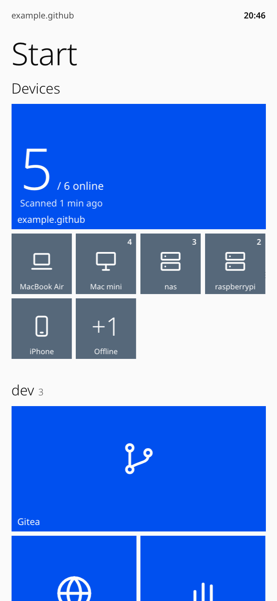

# Tailnet Home

[English](README.md) · [简体中文](README.zh-CN.md)

[Tailscale](https://tailscale.com) 内网主页：一屏 Metro 风格磁贴列出 tailnet 里的所有设备和自建服务。**同时也是一套免费、私有的开发闭环**：在手机上让 Claude 改代码，再用同一部手机刷新浏览器，立刻看到效果。

<p align="center">
  
  &nbsp;
  
</p>

<sub>截图使用 <code>demo/data.json</code> 中的虚构数据。</sub>

## 亮点

- **用 Claude Code Remote Control 随时随地开发。** 开发机上保持 `claude` 运行并打开 Remote Control，出门用手机上的 Claude App 继续指挥。
- **改完立刻在真实浏览器里看到。** `git push` → 自建 Gitea Actions 构建并重新部署 → 手机打开 `https://<服务器>.<tailnet>.ts.net`。看的是真页面，不是来回贴截图。
- **免费。** Tailscale 个人版、Gitea、Docker、nginx 全部免费。不需要 VPS、公网 IP、端口转发、域名和证书——`tailscale serve` 直接给 `*.ts.net` 签 HTTPS。唯一的前提是你本来就在用的 Claude 订阅。
- **默认私有。** 页面和数据只有 tailnet 内的设备能访问。


## 功能

- 列出所有设备（在线/离线、系统、Tailscale IP、MagicDNS 名，一键复制）
- 自动发现 `tailscale serve` 暴露的服务，可选对在线设备探测常见 Web 端口（`--probe`）
- `services.json` 手动维护服务和书签，与自动发现的结果去重
- 可达性由扫描端实测（不受浏览器限制），显示在磁贴状态上
- 键盘直达：`↑↓` 选择、`↵` 打开、`⌘↵` 新标签打开、`Esc` 清除筛选；按标签或设备筛选
- 常用服务按点击次数自动排前（只存在本浏览器）
- 中英文界面，跟随浏览器语言（也可用 `?lang=zh` 或 `services.json` 里的 `"lang"` 指定）
- 一个静态 HTML + 一个只用标准库的 Python 脚本，无构建、无框架、无数据库

## 快速开始

不装 Tailscale 也能先看界面：

```bash
git clone https://github.com/muzig/tailscale-home.git && cd tailscale-home
cp demo/data.json public/data.json
python3 -m http.server -d public 8000      # 打开 http://localhost:8000
```

扫描自己的 tailnet（本机需运行 Tailscale）：

```bash
cp services.example.json services.json     # 可选：加入自己的服务
python3 scan.py --probe                    # 生成 public/data.json
python3 -m http.server -d public 8000
```

## 自建部署（push 即上线）

本仓库实际运行在家里的一台 Mac mini 上：Gitea + Actions runner + Docker + Tailscale。

1. **Gitea 与 runner**：部署 [Gitea](https://about.gitea.com)，以 *host* 模式注册 [act runner](https://docs.gitea.com/usage/actions/act-runner)，把 workflow 里的 `runs-on: macmini` 改成你的 runner 标签。
2. **服务清单**：放在服务器的 `~/src/self-hosted/tailscale-home/var/services.json`（仓库之外，不会被提交）。
3. **推送**：每次 push 到 `main`，workflow 会同步代码、安装扫描 LaunchAgent、按提交号构建镜像、在 `127.0.0.1:4183` 启动、健康检查，并保留最近 5 个镜像。
4. **暴露到 tailnet**（一次性）：

   ```bash
   tailscale serve --bg --set-path / http://127.0.0.1:4183
   ```

   macOS 应用版的 CLI 是 `/Applications/Tailscale.app/Contents/MacOS/Tailscale`，非终端环境需加 `TAILSCALE_BE_CLI=1`。

扫描脚本在宿主机上跑而不进容器，因为要调用宿主机的 Tailscale CLI。回滚：把部署目录 `.env` 里的 `IMAGE_TAG` 改成旧提交前缀，再 `docker compose up -d --no-build`。

## Linux（不用 CI）

不需要 Gitea，在仓库目录里跑容器加一个 systemd 定时器即可：

```bash
git clone https://github.com/muzig/tailscale-home.git ~/tailscale-home && cd ~/tailscale-home
mkdir -p var && cp services.example.json var/services.json      # 按需编辑
docker compose up -d --build                                    # 在 127.0.0.1:4183 提供 var/data.json

mkdir -p ~/.config/systemd/user
for f in deploy/tailscale-home-scan.{service,timer}; do
  sed "s|__DEPLOY_DIR__|$PWD|g" "$f" > ~/.config/systemd/user/"$(basename "$f")"
done
systemctl --user daemon-reload && systemctl --user enable --now tailscale-home-scan.timer
loginctl enable-linger "$USER"                                  # 注销后定时器继续运行

sudo tailscale set --operator="$USER"                           # 让 scan.py 能读取 tailscale serve status
tailscale serve --bg --set-path / http://127.0.0.1:4183
```

更新：`git pull && docker compose up -d --build`。想要 push 即部署，在服务器上装任意 CI runner（Gitea Actions、GitHub Actions 自托管 runner 等），照搬 `.gitea/workflows/deploy.yml` 的步骤即可。

## Claude Code 开发闭环

1. 在开发机打开本仓库，启动 `claude`，执行 `/remote-control`。
2. 手机上的 Claude App 打开这个会话，说出需求，比如“手机上设备磁贴小一点”。
3. Claude 修改、提交、推送，Gitea Actions 一分钟内完成部署。
4. 同一部手机刷新 `https://<服务器>.<tailnet>.ts.net/`。不满意就在同一个对话里继续说。

任何 Web 项目都能套用这个流程，本仓库是一个完整的小例子。

## 说明

- 本项目为非官方社区项目，与 Tailscale Inc. 或 Anthropic 无关联。
- 请只在 tailnet 内提供服务（用 `serve`，不要用 `funnel`）：`data.json` 包含设备名和 IP。见 [SECURITY.md](SECURITY.md)。

## 许可

[MIT](LICENSE)
